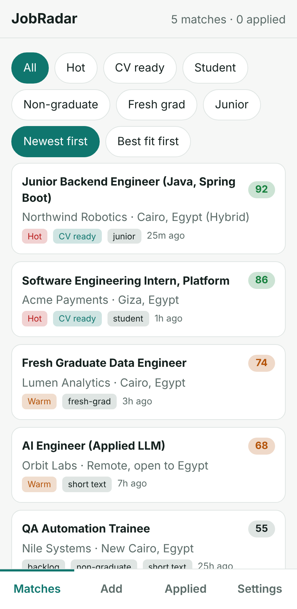
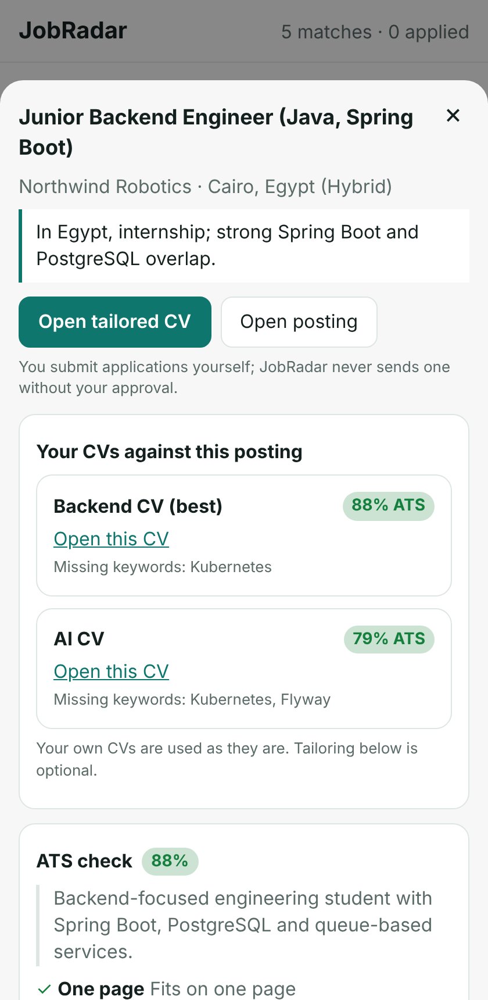
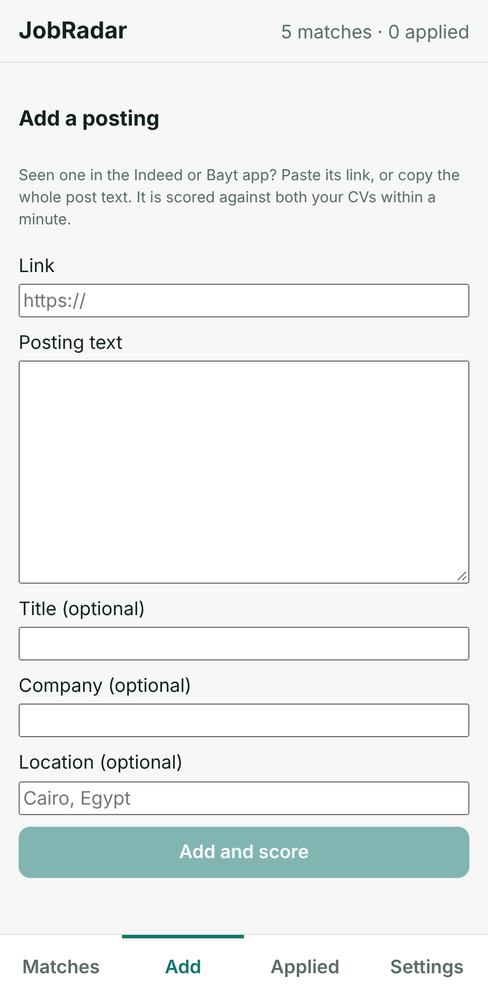
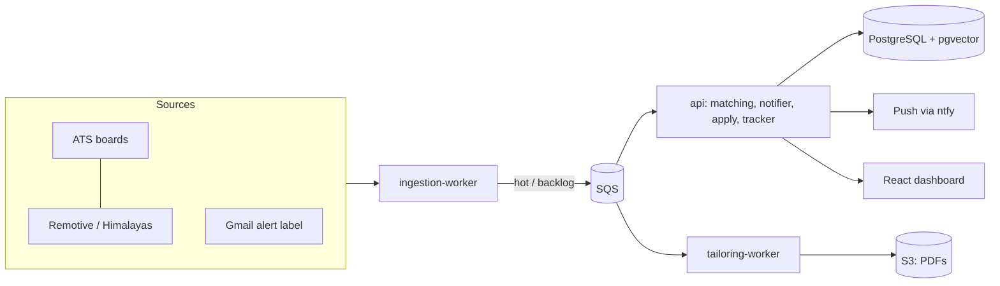

# JobRadar

An Egypt-first job-search copilot. It collects postings from official and public sources, scores them
against your own CVs, and tells you what to apply to and when. **It never submits an application without
your explicit approval.**

<p>
  
  
  
</p>

## What it does

- **Collects postings** from public ATS feeds (Greenhouse, Lever, Workable, Ashby), Remotive and Himalayas,
  and from job-alert emails in one Gmail label you choose (Wuzzuf, Bayt, LinkedIn, Indeed, Glassdoor, Forasna).
- **Filters hard, then scores:** Egypt or remote-from-Egypt, level (student, non-graduate, fresh graduate,
  junior), age (default one week), then embedding similarity and an LLM rerank against your CV bullets.
- **Freshness first:** postings under two hours old go to a hot queue; a new high score triggers an instant
  push, the rest arrives as a daily digest.
- **Scores your own CVs** with an ATS keyword check and shows the best match per posting. An optional
  tailoring step picks and orders existing bullets only; a validator rejects any skill, number or employer
  that is not in your profile.
- **Detects how to apply** (web link, Google Form, email). Email applications send from your Gmail only
  after you tap Approve.
- **Add by hand:** paste a link or the posting text, or paste the full text of an alert-only posting, and it
  is scored the same way.

## Guardrails

1. **No scraping or automation of LinkedIn or Wuzzuf.** Their content only reaches JobRadar through emails
   you receive yourself.
2. Official or public feeds only; each source's terms, rate limits and `robots.txt` are respected.
3. Nothing is submitted without an explicit approval event.
4. No invented content in CVs.
5. No CAPTCHA solving or bot-detection workarounds.
6. Narrow Gmail scopes, one label, tokens in a secrets store.
7. A daily cap on applications.

## Architecture



A modular monolith built with **Spring Modulith**, split into three deployables. Module boundaries are
verified in tests.

| Module | Responsibility |
| --- | --- |
| `profile` | User preferences and the CV bullet store |
| `ingestion` | Source connectors, Gmail alert parsers, dedupe, careers resolver, full-text enrichment |
| `matching` | Hard filters, embeddings, LLM rerank, bands (hot, warm, backlog, deadline) |
| `cvscore` | ATS keyword scoring of the user's own CVs |
| `tailoring` | Bullet selection, no-invention validator, Typst PDF |
| `apply` | Apply flow: approval, Gmail send |
| `notifier` | Push alerts and daily digest |
| `tracker` | Applications, follow-ups |
| `llm` | Provider-neutral chat and embedding clients (OpenAI-compatible API) |
| `api`, `ingestion-worker`, `tailoring-worker` | The three runnable Spring Boot apps |
| `web` | Mobile-first React dashboard |
| `infra` | Terraform (AWS, plan-only by default) |

**Stack:** Java 25, Spring Boot 4, Spring Modulith, PostgreSQL + pgvector, Flyway, SQS and S3 (LocalStack
locally), React + Vite, Terraform, GitHub Actions. Tests use Testcontainers and recorded fixtures; no test
makes a live network call.

## Quick start

```sh
cp .env.example .env                      # fill in the keys you need; .env is git-ignored
docker compose up -d postgres localstack
./mvnw -DskipTests install
PORT=18080 ./mvnw -q -pl api spring-boot:run
(cd web && npm install && npm run dev)
```

Full setup (all three services, Gmail alerts, notifications, configuration keys) is in
[docs/RUNNING_LOCALLY.md](docs/RUNNING_LOCALLY.md). Run the tests with `./mvnw verify` (Docker required).

## Documentation

- [Architecture and research notes](docs/RESEARCH.md): market research, flows, data model
- [Specification](SPEC.md): decisions and per-milestone scope
- [Job-source research](docs/JOB_SOURCES_RESEARCH.md): how job sites and feeds work
- [Product research](docs/PRODUCT_RESEARCH.md): comparable tools

## Status

A working personal project: ingestion, matching, the dashboard and notifications run end to end locally.
Email apply, free hosting and a verified careers-page feed for most companies are not finished.

## License

[MIT](LICENSE)
